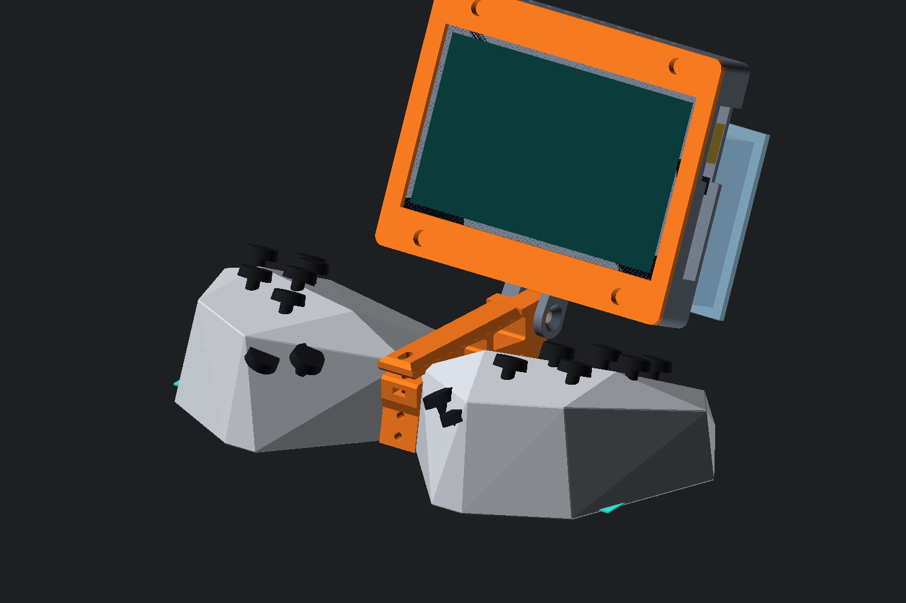
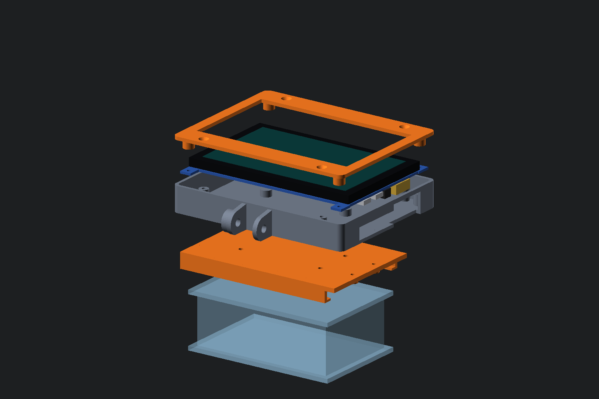
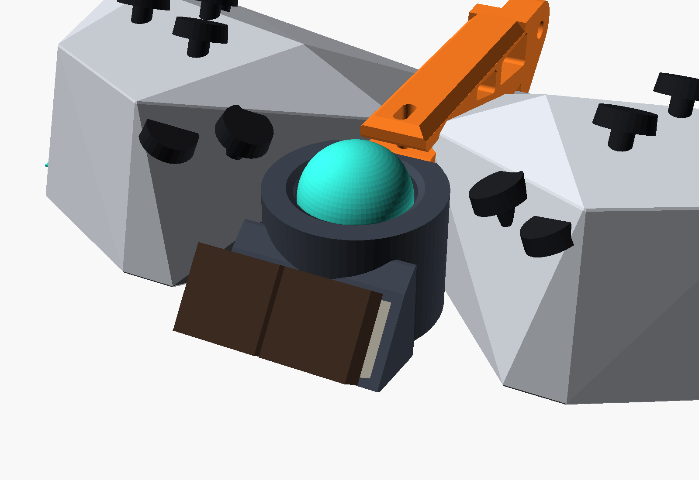

# Cyberdeck: Orange Pi 5 Pro + pantalla de 5" sobre un CharaChorder Master Forge

Cuerpo imprimible para un cyberdeck de regazo. La pantalla y la Orange Pi forman una **cabeza** articulada que se
sujeta al teclado con una **espina**; el teclado se usa entero, sin desmontarlo.

La Orange Pi no se saca de su caja de metacrilato: la caja se desliza en dos raíles a la espalda del marco de la
pantalla y todos los cables van por fuera.





## Estado

Diseño en pruebas. Lo que está comprobado y lo que no:

| | Estado |
|---|---|
| Agujeros, fondo y conector HDMI de la pantalla | Comprobado con una plantilla impresa |
| Piezas cerradas y sin choques entre sí | Comprobado en el modelo |
| Giro de la articulación de 0° a 100° hacia atrás | Comprobado en el modelo |
| Resistencia de la espina | Calculada (ver abajo), no ensayada |
| Encaje de los raíles con la caja de metacrilato | Sin probar con la holgura actual: imprime antes `cabeza/probeta3.stl` |
| Posición de los tornillos de la caja de metacrilato | Estimada sobre una foto |
| Vuelco hacia atrás sobre una mesa | Sin comprobar |

## Piezas

| Archivo | Qué es | Peso (PETG) | Cómo se imprime |
|---|---|---|---|
| `cabeza/marco.stl` | Marco delantero de la pantalla | 17 g | Cara vista hacia abajo |
| `cabeza/cuerpo.stl` | Cuerpo de la pantalla, con las orejas de la articulación | 60 g | Espalda sobre la cama |
| `cabeza/corredera.stl` | Raíles para la caja de metacrilato | 49 g | De pie sobre el extremo del tope, con borde de adherencia |
| `cabeza/espina.stl` | Unión con el teclado | 23 g | De lado |
| `cabeza/probeta3.stl` | Rebanada de los raíles, para probar el encaje | 5 g | De pie |
| `pared/pared_usb.stl` | Repuesto de la pared de USB y red de la caja de metacrilato | 5 g | Tumbada, relleno al 100 % |

Ninguna necesita soportes. Están pensadas para una Bambu Lab P1S y PETG.

La cabeza mide 127,9 × 101,4 mm y 66,7 mm de fondo con la caja de metacrilato puesta.

## Trackball central (en diseño)

Un módulo con bola de 25 mm y sensor PMW3360 que se atornilla a las dos roscas M3 que la garra de la espina ya
tiene en la cara que mira a las palmas. La bola queda entre las dos palancas de pulgar, con la parte de arriba a
39,5 mm de la mesa.



| Archivo | Qué es | Peso (PETG, macizo) | Cómo se imprime |
|---|---|---|---|
| `trackball/soporte.stl` | Cuña que se atornilla a la garra y acaba en un raíl de cola de milano | 2 g | De pie sobre su base |
| `trackball/carcasa.stl` | Aloja la bola, tres bolitas de apoyo y la placa del sensor; baja deslizando por el raíl | 27 g | Sobre su base |
| `trackball/tapa.stl` | Cierra por debajo la cámara del sensor | 1 g | Plana |

Montaje: primero el soporte, con 2 × M3×8 Allen (no más largos: la punta queda enrasada con la cara de la garra que
toca el teclado). Luego la placa del sensor y la tapa (2 × M2×6 que roscan en el plástico), las tres bolitas de 5 mm
(cerámica o acero) y la bola. La carcasa baja por el raíl desde arriba.

El sensor va por cable a una placa RP2040 con QMK, que se presenta a la Orange Pi como un ratón USB normal.

Sin comprobar todavía:

- Las medidas de la placa del sensor y de la lente (`nav_pcb`, `pcb`, `chip_h`, `lente` al principio de
  `trackball/trackball.scad`) son supuestas: hay que corregirlas con la placa que se compre.
- La holgura con las mitades del teclado sale del volumen de referencia (`ref_forge.scad`), que en el centro se
  tomó en parte de fotos: unos 0,6 mm en el peor punto, abajo y detrás.
- Los clics: falta ver si el firmware del Master Forge puede mandar clics de ratón desde las palancas.

Para regenerar: `openscad -o trackball/carcasa.stl --export-format binstl -D 'pieza="carcasa"' trackball/trackball.scad`
(también `soporte` y `tapa`; `pieza="conjunto"` lo muestra montado).

## Tornillería

| Unión | Tornillo |
|---|---|
| Marco al cuerpo | 4 × M3×12 Allen de cabeza cilíndrica |
| Corredera al cuerpo | 4 × M3×8 Allen de cabeza cilíndrica |
| Cierre de la caja en los raíles | 2 × M3×10 Allen de cabeza cilíndrica |
| Articulación | 1 × M5×20 de cabeza cónica, con tuerca |
| Garra de la espina | 1 × M3 con tuerca y arandela |

Los M3 roscan directamente en el plástico. La pantalla no lleva tornillos: la sujetan cuatro pivotes impresos y el
marco.

## Medidas en las que se basa

Todas tomadas con calibre sobre las piezas reales.

**Pantalla HDMI de 5"**

| Medida | Valor |
|---|---|
| Agujeros de las orejas, entre centros | 113,5 × 86,5 mm (⌀ 2,5) |
| Placa | 120 × 76 mm |
| Orejas | sobresalen 9 mm, 8 mm de ancho |
| Del cristal al dorso de la placa | 8 mm |
| Del cristal a la punta del conector más alto | 14,5 mm |

**Caja de metacrilato de la Orange Pi 5 Pro** (kit con ventilador y antena)

| Medida | Valor |
|---|---|
| Exterior | 105 × 71 × 40 mm |
| Placas | 3 mm, sobresalen 4 mm de las paredes |
| Tornillos de la placa de abajo | sobresalen 1 mm |

Si tu pantalla o tu caja son de otro modelo, cambia esas medidas al principio de `cabeza/mochila.scad` e imprime
primero la plantilla (`pieza="plantilla"`) y la probeta (`pieza="probeta"`).

## Límites de uso

- La pantalla no pasa de la vertical hacia delante.
- Sobre una mesa, la caja de metacrilato toca la mesa a unos 39° de inclinación hacia atrás.
- El peor caso calculado para la espina es un golpe lateral de 12 N en la esquina de la pantalla: 15,4 MPa, con un
  margen de 1,2 frente a la rotura entre capas del PETG. No es una pieza para llevarse golpes de lado.

## Fuentes

Los modelos están en [OpenSCAD](https://openscad.org/) y son paramétricos.

| Archivo | Contenido |
|---|---|
| `cabeza/mochila.scad` | Marco, cuerpo, corredera, probeta y plantilla |
| `cabeza/espina.scad` | Espina |
| `cabeza/conjunto.scad` | Vista del conjunto sobre el teclado (no se imprime) |
| `cabeza/ref_forge.scad` | Volumen de referencia del teclado |
| `pared/pared.scad` | Pared de repuesto de la caja de metacrilato |
| `cabeza/fea.py`, `cabeza/prueba_espina_v5.py` | Cálculo de resistencia de la espina |

Para regenerar una pieza:

```bash
openscad -o cabeza/cuerpo.stl --export-format binstl -D 'pieza="cuerpo"' cabeza/mochila.scad
```

`pieza` puede ser `marco`, `cuerpo`, `corredera`, `probeta` o `plantilla`. Para la espina:

```bash
openscad -o cabeza/espina.stl --export-format binstl -D 'pieza="espina"' cabeza/espina.scad
```
